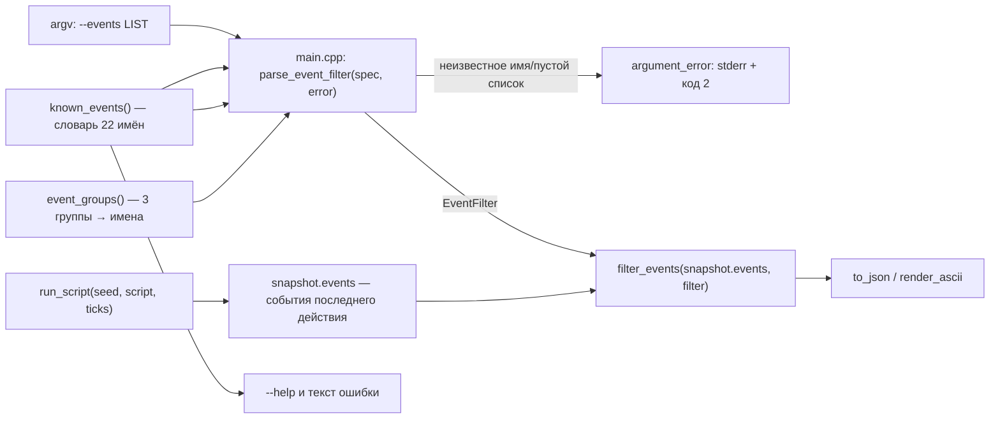

# Design

## Context

Мотивация — в `proposal.md`. Требования к группам — в спецификации изменения.

Сейчас фильтр принимает только точные имена (`--events clear:tetris,combo`). Частые запросы — «любая линия», «любой tspin» — требуют перечислять 4–5 имён вручную, и потребитель должен знать словарь наизусть. Группы сокращают это до `--events clear` и `--events tspin`.

Имена событий и их источник — см. `openspec/specs/event-reporting/spec.md`; форма `clear:<метка>` зафиксирована в спеке и подтверждена тестом на реальной партии.

## Goals / Non-Goals

**Goals:**
- Группы как сахар поверх словаря: `clear` (девять `clear:*`), `tspin` (пять `clear:tspin*`), `all` (все 22 имени).
- Группа и точное имя смешиваются в одном списке (`--events clear,combo,b2b`).
- Ядро не меняется: группы разворачиваются в существующий `EventFilter`.

**Non-Goals:**
- Фильтр по подстрокам, регулярным выражениям и префиксу `clear:*` как шаблону.
- Новые события или изменение их генерации.
- Группы в MCP-инструментах и в SDL.

## Decisions

Поток данных не меняется по существу — добавляется один шаг разворачивания групп:

**D1. Разворачивание группы — в `parse_event_filter`, до проверки имён.** Группа превращается в набор точных имён из того же словаря `known_events()`, поэтому отдельных проверок не требуется, а `EventFilter` остаётся прежним типом. Альтернатива «хранить в фильтре имя группы» заставила бы `filter_events` знать про группы — лишняя связность.

**D2. Группа — функция ядра, а не таблица в CLI.** `event_groups()` живёт рядом со словарём в `src/core/events.cpp`, чтобы список групп и их состав не разъезжались со словарём и были покрыты юнит-тестами. `main.cpp` по-прежнему только передаёт строку.

**D3. Коллизия «группа vs имя» решается в пользу группы.** Сейчас имён `clear`, `tspin`, `all` не существует, поэтому конфликта нет; правило фиксируем в спеке, чтобы будущее имя с таким же написанием не сломало разбор молча.

**D4. Состав групп фиксирован в спеке, а не вычисляется по префиксу.** `clear` — ровно девять имён `clear:*` из словаря, `tspin` — пять `clear:tspin*`, `all` — все 22. Вычисление по префиксу выглядит элегантнее, но делает состав зависимым от порядка добавления имён и скрывает его от читателя спеки.

**D5. `all` — явная группа, а не «пустой фильтр».** Пустой список остаётся ошибкой (требование действующей спеки), поэтому «показать всё» выражается отдельным словом, а не отсутствием значения.

**D6. Диагностика не меняется.** Неизвестное имя по-прежнему даёт код 2 с перечнем; в перечень добавляются три группы, чтобы опечатка `--events clea` подсказывала `clear`.

**D7. MCP и SDL не трогаем.** Они вызывают тот же бинарь без нового флага.

## Risks / Trade-offs

- [Слово-группа может совпасть с будущим именем события] → правило D3 зафиксировано в спеке, а тест «все имена словаря не совпадают с именами групп» падает при добавлении такого события.
- [Группы дублируют часть словаря в документации] → состав групп проверяется тестом против `known_events()`, поэтому расхождение видно на сборке.
- [Пользователь ждёт маски вида `clear:*`] → в Non-Goals; при необходимости вводится отдельным изменением.

## Покрытие тестами

Существующие тесты, на которые опирается решение:
- `tests/test_events.cpp` — разбор списка, отбор, закреплённый словарь, кейс `clear:tspin_mini` на реальной партии;
- `tests/test_scoring.cpp` — источник меток `clear_label`, из которых собираются имена `clear:*`;
- `tests/test_serialize.cpp` — наличие и формат ключа `events` в JSON;
- `tests/test_game.cpp` — семантика «события последнего действия» (очистка набора в `Game::apply`).

Новый файл тестов: `tests/test_event_groups.cpp` — состав трёх групп, смешивание группы и точного имени, ошибка на неизвестной группе, отсутствие коллизий с именами словаря.
