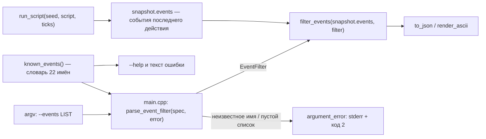

## Decisions (фрагмент «после» правила проекта)

Поток данных при фильтрации событий:

**D1. Фильтр живёт в ядре, а не в `main.cpp`.** `src/main.cpp` не входит в `tetris_tests`, поэтому логика там непроверяема юнитами. Альтернатива «разобрать список прямо в CLI» быстрее в реализации, но оставляет единственную проверку ручной.

**D2. Отдельный модуль `include/tetris/core/events.hpp` + `src/core/events.cpp`.** Словарь имён и разбор списка — самостоятельная ответственность; `game.hpp` уже импортируется везде, и складывать туда строковый протокол вывода значит смешивать состояние игры с форматом отчёта. `CMakeLists.txt` подхватит новый `.cpp` через существующий GLOB.

**D3. Неизвестное имя — ошибка, а не тихий отсев.** Тот же принцип, что у неизвестного токена `--script`: успешный прогон с опечаткой в фильтре выглядит как «событий не было» и уводит в неверный вывод. Цена — потребитель обязан знать словарь; словарь публикуется в `--help` и в сообщении об ошибке.

**D4. API — два вызова, оба чистые.**
- `std::optional<EventFilter> parse_event_filter(std::string_view spec, std::string& error)` — разбор списка: обрезка пробелов, разбиение по запятой, проверка имён по словарю, отказ на пустом списке и на неизвестном имени (текст ошибки в `error`).
- `std::vector<std::string> filter_events(const std::vector<std::string>& events, const EventFilter& filter)` — отбор с сохранением порядка исходного набора.
- `const std::vector<std::string>& known_events()` — словарь 22 имён, единый источник для проверки, сообщений и `--help`.

`EventFilter` — множество (`std::set<std::string>`): порядок результата задаёт снапшот, а не список пользователя, поэтому дубликаты в запросе схлопываются бесплатно.

**D5. Применение — в `main.cpp` сразу после `run_script`, до печати.** Мутируется только `snapshot.events`; `to_json` и `render_ascii` не меняются, поэтому остальные ключи и ASCII не затрагиваются. Флаг с `--ascii` допустим и просто ни на что не влияет.

**D6. Диагностика — через существующий `argument_error`.** Код 2, сообщение с неверным именем и перечнем допустимых; пустой список — отдельное сообщение. Взаимных исключений с другими флагами нет: единственная существующая пара — `--json`/`--ascii`.

**D7. MCP-сервер не трогаем.** `tetris_mcp.py` вызывает тот же бинарь без нового флага; расширение инструментов не входит в требования.

## Покрытие тестами

- `tests/test_events.cpp` — разбор списка, отбор, закреплённый словарь, кейс `clear:tspin_mini` на реальной партии: закрывает D1–D4.
- `tests/test_scoring.cpp` — источник меток `clear:*`, из которых собран словарь: закрывает D3.
- `tests/test_serialize.cpp` — ключ `events` в JSON: подтверждает, что фильтр меняет только его.
- `tests/test_game.cpp` — семантика «события последнего действия»: подтверждает, что D5 применим до печати.
