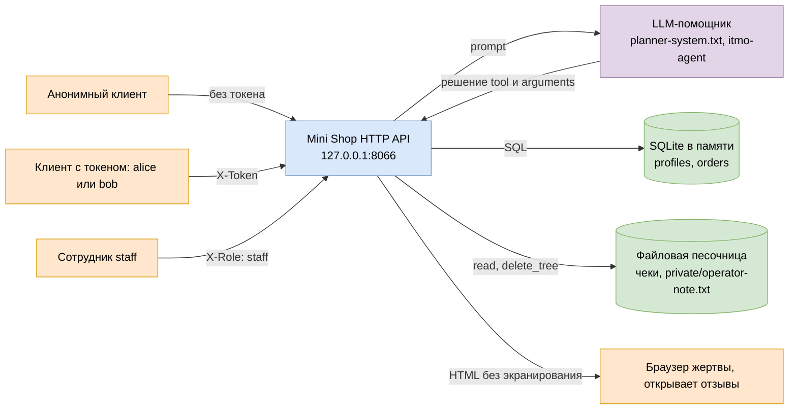
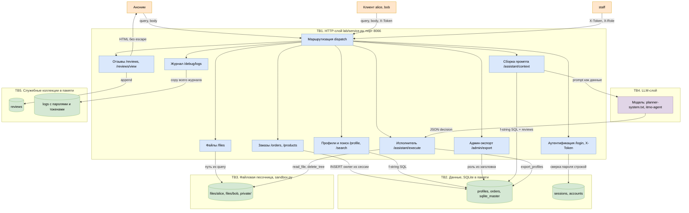
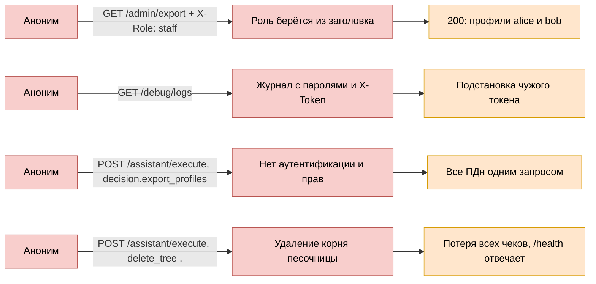
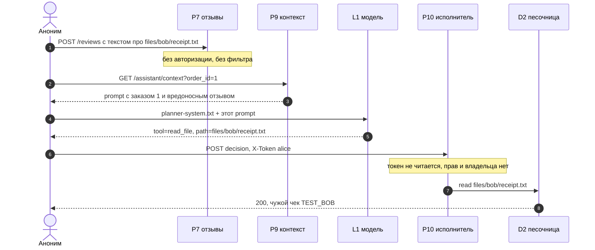
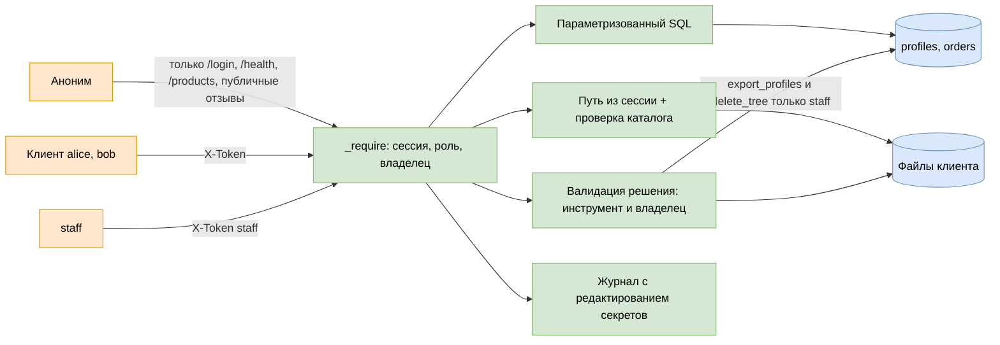

# Модель угроз: Mini Shop (состояние до фикса)

Модель построена по `REPORT_01.md`: 15 подтверждённых находок, код на коммите до фикса
(`git show 9340f7f^:practices/practice_06/lab/service.py`). Метод — моделирование угроз
Microsoft: описание системы и границ доверия → активы → поиск угроз по STRIDE → меры →
проверка. Состояние после фикса и остаточные риски — в `REPORT_02.md`, сверка с целевой
схемой — в разделе 10.

Границы этого документа:

- оценивается только HTTP-поверхность `lab/service.py` (порт `127.0.0.1:8066`);
- `lab/sandbox.py` считается неизменяемым и работает корректно: выход наружу через `../`,
  абсолютный путь и симлинк отбиваются, shell и внешних URL нет;
- все данные синтетические, стенд слушает loopback, эксплуатация внешних сервисов не
  выполнялась;
- угрозы физического доступа, ОС и сети вне области: сервис учебный и однопроцессный.

## 1. Активы и классификация данных

| ID | Актив | Где лежит | Класс данных | Ущерб при компрометации | Угрозы |
|---|---|---|---|---|---|
| A1 | Профили: `id, name, email, address` | SQLite в памяти, таблица `profiles` | ПДн (152-ФЗ) | утечка ПДн всех клиентов, штраф, потеря доверия | T-01, T-02, T-04, T-05, T-07, T-13 |
| A2 | Заказы: `owner, product, price` | SQLite в памяти, таблица `orders` | коммерческие данные | подмена цены, убыток магазина, искажение истории | T-03, T-07, T-09 |
| A3 | Чеки клиентов `files/<user>/receipt.txt` | файловая песочница во временном каталоге | финансовый документ + ПДн | чтение чужого чека, потеря чеков | T-04, T-07, T-08, T-11, T-12 |
| A4 | Служебная заметка `private/operator-note.txt` | файловая песочница, вне каталогов клиентов | служебная тайна | раскрытие внутренней процедуры | T-04, T-08, T-11 |
| A5 | Отзывы: текст от любого клиента | список в памяти → HTML `/reviews/view` | пользовательский контент, недоверенный ввод | stored XSS в браузере жертвы, канал инъекции в промпт | T-10, T-11, T-15 |
| A6 | Журнал запросов | список в памяти, выдаётся `/debug/logs` | секреты: пароли, `X-Token` | захват активных сессий без подбора | T-06, T-14 |
| A7 | Сессии и учётные данные | `sessions` в памяти, пароли в коде | аутентификационные данные | вход под чужим аккаунтом, бессрочный доступ | T-06, T-14 |
| A8 | Схема БД (DDL, имена таблиц) | `sqlite_master` | внутренняя конфигурация | карта для дальнейших инъекций | T-01, T-02, T-13 |
| A9 | Доступность и целостность стенда | процесс, песочница, `shop.lock` | сервис | отказ в обслуживании, потеря фикстур | T-12, T-15 |

## 2. Границы доверия

- **TB1 — клиент ↔ HTTP-слой.** Всё, что приходит по сети, недоверенно: query, тело, заголовки,
  включая `X-Token` и `X-Role`. В исходном коде эта граница фактически отсутствует: одни
  маршруты не читают токен вовсе, другие верят заголовку роли.
- **TB2 — HTTP ↔ SQLite.** Строка запроса собирается конкатенацией пользовательских значений,
  поэтому граница прозрачна: клиент влияет на SQL.
- **TB3 — HTTP ↔ файловая песочница.** `sandbox.py` держит границу наружу, но внутри песочницы
  (`..` между каталогами клиентов и `private/`) проверки нет.
- **TB4 — HTTP ↔ LLM ↔ исполнитель.** Отзывы и вопрос попадают в промпт как данные без
  разделителей; решение модели идёт в `/assistant/execute` без аутентификации, проверки схемы,
  прав и владельца объекта.
- **TB5 — HTTP ↔ служебные коллекции (журнал, отзывы, сессии).** Журнал читается без
  авторизации и содержит секреты; коллекции растут без границ.

## 3. Поток данных, уровень 0 (контекст)

## 4. Поток данных, уровень 1 (элементы и границы)

## 5. STRIDE по элементам

| Элемент | S | T | R | I | D | E | Угрозы |
|---|:-:|:-:|:-:|:-:|:-:|:-:|---|
| P2 аутентификация и сессии | да | | да | | | да | нет лимита попыток, токен бессрочный, logout отсутствует → T-14 |
| P3 заказы | | да | | | | | цена приходит из тела → T-09 |
| P4 профили и поиск | | да | | да | | | SQLi конкатенацией, нет проверки владельца → T-01, T-02, T-07 |
| P5 админ-экспорт | да | | | да | | да | роль из заголовка → T-05 |
| P6 файлы | | да | | да | | | `..` внутри песочницы, чужой каталог → T-08 |
| P7 отзывы | | да | | да | | | stored XSS, недоверенный контент идёт в промпт → T-10, T-11 |
| P8 журнал | | | | да | да | | пароли и токены без авторизации, рост без границ → T-06, T-15 |
| P9 сборка промпта | | да | | да | | | SQLi в `order_id`, контекст отдаётся клиенту напрямую → T-03 |
| P10 исполнитель | да | да | да | да | да | да | нет аутентификации и прав, любое решение из тела → T-04, T-11, T-12 |
| L1 модель | да | | | | | да | данные притворяются инструкциями, решение не валидируется → T-11 |
| D1 SQLite | | да | | да | да | | выгрузка через UNION, изменение через инъекцию → T-01..T-03, T-09 |
| D2 песочница | | да | | да | | | чтение и удаление чужих файлов → T-08, T-12 |
| D3 сессии и учётные данные | да | | | да | | да | пароли открытым текстом в коде → T-14 |
| D4 reviews, D5 logs | | да | | да | да | | раздувание коллекций, утечка секретов → T-06, T-15 |
| TB1 сетевой вход | да | | да | | | | единственная точка, где должна решаться аутентификация, но решается по-разному в каждом маршруте |

## 6. Реестр угроз

Severity — как в `REPORT_01.md`. Колонка «Проверка» — раздел отчёта с командой и выводом;
«Регрессия» — тест в `lab/test_security.py`, который закрывал эту угрозу после фикса.

| ID | Угроза | Элемент | STRIDE | CWE | Severity | Проверка | Мера | Регрессия |
|---|---|---|---|---|---|---|---|---|
| T-01 | SQLi в `GET /profile?id=`: логическая и UNION к `sqlite_master`, полная выгрузка таблиц | P4, D1 | T, I | 89 | Critical | REPORT_01 п.1 | параметры `WHERE id = ?`, id только цифры иначе 400 | `test_profile_injection_is_rejected` |
| T-02 | SQLi в `GET /search?q=`: LIKE-инъекция без токена, UNION | P4, D1 | T, I | 89 | Critical | п.2 | параметры, `ESCAPE` и экранирование `%`/`_`, выдача только своих | `test_search_injection_returns_only_own_profile` |
| T-03 | SQLi в `GET /assistant/context?order_id=`: расширение выборки в промпте, промпт отдаётся клиенту | P9, D1 | T, I | 89 | Critical | п.3 | параметры плюс `WHERE owner = сессия` | `test_assistant_context_injection_is_rejected` |
| T-04 | `/assistant/execute` без аутентификации: любой инструмент от любого клиента, `X-Token` не читается | P10 | E, I, T | 306, 862 | Critical | п.4 | обязательная сессия, белый список инструментов по роли, владелец объекта на сервере | `test_assistant_execute_requires_session_and_permissions` |
| T-05 | Подделка `X-Role: staff` на `/admin/export`: выгрузка всех ПДн одним заголовком | P5, D1 | S, E | 807, 285 | Critical | п.5 | роль только из серверной сессии, заголовок игнорировать | `test_role_header_does_not_grant_staff` |
| T-06 | `/debug/logs` без авторизации отдаёт тела `/login` и `X-Token`: захват активных сессий | P8, D5 | I | 532, 306 | High | п.6 | редактирование секретов при записи, allowlist полей, доступ только staff | `test_debug_logs_are_staff_only_and_redacted` |
| T-07 | IDOR: профиль, заказы, чеки, контекст по чужому id и без сессии | P4, P3, P6, P9 | I | 639 | High | п.7 | субъект из сессии, `WHERE owner = ?`, чужой объект → 404 | `test_profile_of_another_customer_is_hidden`, `test_orders_are_scoped_to_the_session` |
| T-08 | Path traversal внутри песочницы: `user=alice&path=../../private/operator-note.txt` | P6, D2 | I, T | 22 | High | п.8 | каталог из сессии, проверка `target == base or base in target.parents`, белый список файлов | `test_files_are_limited_to_the_owner_directory` |
| T-09 | Подмена цены в `POST /orders`: 1 рубль и отрицательная цена | P3, D1 | T | 472 | High | п.9 | цена только из серверного каталога, `price` из тела игнорировать | `test_price_cannot_be_overridden` |
| T-10 | Stored XSS в `GET /reviews/view`: скрипт исполняется в браузере жертвы | P7, U1 | T, I | 79 | High | п.10 | `html.escape`, CSP `default-src 'none'`, `nosniff`, `DENY`, авторизация записи | `test_review_html_is_escaped`, `test_html_has_csp_and_no_script` |
| T-11 | Prompt injection через отзыв: модель сама выбирает чужой чек, исполнитель его отдаёт | P7, L1, P10 | S, T, E | 77, LLM01 | High | п.11 | данные между `BEGIN DATA` и `END DATA`, валидация решения на сервере, права по владельцу заказа | `test_assistant_execute_requires_session_and_permissions` |
| T-12 | Уничтожение данных через `delete_tree` без прав и подтверждения: `files` и `.` | P10, D2 | T, D | 73, 306 | High | п.12 | удаление только staff, запрет корня и каталога клиента целиком, id объекта вместо пути | `test_staff_delete_stays_inside_a_user_directory` |
| T-13 | Раскрытие SQL, типов исключений и абсолютных путей в ответах 500 | P1 | I | 209 | Medium | п.13 | 400/415 на невалидный ввод, общий `internal error`, детали в серверный журнал | `test_errors_do_not_leak_internals`, `test_invalid_json_is_a_client_error` |
| T-14 | Слабые сессии и вход: бессрочный токен, нет logout, нет лимита попыток, пароли открытым текстом | P2, D3 | S, R, E | 613, 307 | Medium | п.14 | PBKDF2 с солью и `compare_digest`, лимит по паре источник и логин, TTL, `POST /logout` | `test_login_is_rate_limited`, `test_logout_revokes_the_token`, `test_expired_session_is_rejected` |
| T-15 | Нет лимитов и защитных заголовков: журнал и отзывы растут без границ, один `shop.lock`, нет CSP | P8, D4, D5 | D | 770, 693 | Low | п.15 | квоты на коллекции и длину промпта, TTL журнала, лимит потоков, защитные заголовки | `test_html_has_csp_and_no_script`, `test_wrong_content_type_is_rejected` |

## 7. Цепочки атаки

Три наиболее опасные цепочки из `REPORT_01.md`: каждая начинается без учётной записи.

Цепочка через LLM-слой: инъекция в отзыв.

Ключевой вывод по TB4: защита не может опираться на послушание модели. На грубую
инструкцию модель ответила `refuse`, но принудительно переданное решение всё равно
выполнилось, потому что серверного барьера нет.

## 8. Меры по границам доверия

| Граница | Что должно быть на границе | Чем закрывается |
|---|---|---|
| TB1 | единая точка аутентификации: субъект, роль и владелец берутся только из серверной сессии; заголовки ролей игнорируются | `_require`, таблица `sessions`, 401/403 на входе |
| TB2 | параметризованный SQL и типизация идентификаторов | `WHERE id = ?`, `str.isdigit`, иначе 400 |
| TB3 | путь выбирается сервером и проверяется принадлежность каталогу клиента | `Sandbox`, `is_file()`, 404 вместо 403 |
| TB4 | данные отделены от инструкций, решение модели валидируется по схеме и правам | маркеры `BEGIN DATA` и `END DATA`, белый список инструментов по роли |
| TB5 | секреты не попадают в журнал, коллекции ограничены | редактирование `password` и `X-Token`, allowlist, квоты |

Проверка модели угроз выполнена двумя способами, и они не взаимозаменяемы: `make test` на
исходном коде даёт 16 зелёных тестов (это контракт функциональности, а не безопасность), а
каждая угроза T-01..T-15 подтверждена запросом и ответом в `REPORT_01.md`. После фикса тот же
набор атак прогнан повторно (`REPORT_02.md`) и закреплён регрессией в `lab/test_security.py`.

## 9. Что не подтвердилось и что вне модели

- Выход из песочницы наружу не воспроизводится: `../`, абсолютные пути и симлинк отбиваются,
  `/etc/passwd` недостижим.
- Подделка токена не работает: случайный или пустой `X-Token` даёт 401 на `POST /orders`.
- Стековые инъекции (`; DROP`) не выполняются: `sqlite3.execute` принимает один оператор,
  работают только UNION и логические условия.
- SSRF, shell и чтение внешних URL невозможны: таких маршрутов нет.
- Второй канал инъекции — параметр `question` в `/assistant/context` — отдельным прогоном модели
  не проверялся; в промпт он вставляется так же, как отзывы, поэтому T-11 распространяется и на
  него как на непроверенное предположение.
- DoS через параллельные соединения и медленные запросы отмечен как риск T-15 без нагрузочной
  проверки.
- Не в области модели: компрометация ОС, сети и самого процесса модели, цепочка поставки весов.

## 10. Целевое состояние после фикса

Схема для сверки модели с `REPORT_02.md`: сплошные стрелки — разрешённые потоки, роли
проверяются на сервере.

